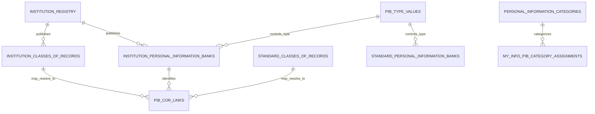

# PIBs relational data model

The machine-readable model is [`data_model.json`](data_model.json). Its hub is the
authoritative `institution_registry.institution_id`; `gc_orgID` remains an optional external
identifier and is not used as a filesystem or relational key.

`pib_cor_links.csv` normalizes the many-to-many relationship currently embedded in the
English and French `related_record_number` text. Its `relationship_scope` distinguishes
institution-specific from standard Classes of Records, and `resolved` makes unresolved source
references auditable rather than silently discarding them.

The institution PIB table stores explicit description enumerations in
`specific_information_types_en` and `specific_information_types_fr`. These fields are JSON arrays
inside the CSV so individual source-language values remain unambiguous even when they contain
commas. They are conservative derivations: an empty array means no explicit list phrase was found,
not that the underlying PIB contains no personal information.

The adjacent `standard_personal_information_category_ids`,
`standard_personal_information_categories_en`, and
`standard_personal_information_categories_fr` JSON arrays contain conceptual matches against the
official category vocabulary. The derivation considers only the bilingual PIB descriptions and
their extracted specific information types; it does not infer categories from program titles,
purposes, uses, or institution names.

`pi_categories_en_fr.csv` is the official controlled vocabulary, but current Info Source
publications do not provide explicit category assignments for each PIB. My Info therefore keeps
the compiler's deterministic description-based assignments in a separate derived table. Every relationship has
confidence and source-field evidence, and is presented as an estimate rather than source metadata.

`data/derived/my_info/my_info_pib_features.csv` uses a source-scoped `record_id` so standard and
institution-specific PIBs can share one feature table without conflating reused bank numbers. The
full category, interaction, retention, bilingual, and matching evidence is retained in
`my_info_derivation_evidence.jsonl`.

The Network Explorer’s schema-version-3 projection in `site/data/graph.json`
exposes institutions, institutional and standard PIBs/classes, privacy assessments
and unresolved references as nodes. PIB types and personal-information categories
are record attributes rather than independent entities in this projection.
The deterministic description classifier supplies estimated category values with
source-field evidence, rules and confidence in the PIB’s lazy attribute shard.
PIB types retain controlled-value definitions separately from category estimates.
Explicit standard PIB PRN/NDP references still connect to standard classes. No
standard PIB-to-institution adoption is inferred. All available node/edge fields
start collapsed in the information panel; navigation and browsing sit outside it.
See [graph methodology](docs/GRAPH_EXPLORER.md).

## Complete network schema diagram

The [interactive full model](https://patlittle.github.io/pibs/data-model.html),
[standalone SVG](https://patlittle.github.io/pibs/data/network-schema.svg)
and [field catalogue](https://patlittle.github.io/pibs/data/network-schema.json) inventory every source table,
nested record shape and graph-projection field. `scripts/build_network_schema.py`
reads owning CSV headers and actual PIA/graph structures. External AIA schema is
field metadata only; the payload remains outside the repository. Collection maps
use parameterized keys rather than counting each institution name as a field.

The explorer follows this structure with one selected record, meaningful groups
of direct connections and explicit two-step evidence paths. A shared owner alone
does not create a recommended path. See [interaction design and source meaning](docs/GRAPH_EXPLORER.md).

## External AIA projection

Algorithmic Impact Assessments are an external, browser-loaded source configured
in `site/aia-source.json`, rather than an additional persisted CSV table in
`data_model.json`. The normalized in-memory AIA key is `package_id` (a unique
source UUID), and `institution_id` is a nullable, uniquely resolved registry
foreign key. Responsible officials retain `name_en`, `name_fr` and a generated
organization-scoped `u_id`. AIA → official and explicit AIA → PIB/class/PIA
references are many-to-many; unknown or ambiguous citations retain their evidence
and candidate IDs without asserting foreign-key matches. Survey version and
feed-derived risk level belong to the AIA alone. No AIA data is copied into the
repository. See [field mappings and matching proposal](docs/AIA_INTEGRATION.md).

## Service Inventory joins

The Service Inventory adds annual service and standard observations, an exact
organization-slug crosswalk, organization-scoped programs, and normalized annual
service/program links. All 70 published fields are retained. The graph presents
stable service/program/standard entities and nests reporting-year observations
in their collapsed attributes. External AIA `data.ServiceID` resolves by literal
service ID within a uniquely matched institution.

See the [field inventory and join ledger](docs/SERVICE_INVENTORY_JOINS.md) for
composite keys, provenance, unresolved codes and evidence limits.

## Public Accounts and GC InfoBase

The 2025–2026 Chart of Accounts uses `(fiscal_yr, accounts_entity, account_code)`
for programs, core responsibilities and non-budgetary codes. A published program
row identifies its parent core code. Department attributions retain the Chart's
Receiver General number, even where the accounting department and named entity
differ. A unique registry `rg` value resolves an accounting department.

An observed Service Inventory program reference can join by fiscal year, code
and institution. GC InfoBase joins the other side through the same institution
and its separate `infobaseID`. The join ledger distinguishes an annual service
reference, a catalogue comparison, and an external record key. See the
[Public Accounts join ledger](docs/PUBLIC_ACCOUNTS_JOINS.md).
