# PIA list discovery

The discovery stage parses **intermediate artifacts produced earlier in the data
pipeline** to aggregate institutional links to Privacy Impact Assessment (PIA)
summary lists. The collection stage then reads those list pages, identifies
individual assessments, and exports their English and French content. French
sources commonly refer to EFVP, EFRVP, or EFPV.

```mermaid
flowchart LR
    A[Institution registry and collection jobs] --> B[Earlier Info Source collection]
    B --> C[Intermediate artifacts:<br/>bilingual PIB and class Markdown,<br/>raw HTML snapshots, source manifests]
    C --> D[Parse PIA references and links<br/>with source evidence]
    A --> E[Join stable organization IDs]
    D --> E
    E --> F[Check HTTP responses and redirects<br/>follow at most two navigation links]
    F --> G[Check explicit EN/FR language links<br/>when a counterpart is missing or stale]
    G --> H[PIAs/index.csv<br/>aggregated bilingual list pointers]
    G --> I[Evidence, HTTP history<br/>and unresolved cases]
    H --> J[Enumerate individual PIA summaries<br/>and follow nested list pages]
    J --> K[Separate inline summaries by heading<br/>or retrieve individual HTML/PDF pages]
    K --> L[Match EN/FR sources using evidence]
    L --> M[Organization folders:<br/>collection.json, raw captures,<br/>PIA_en.md and PIA_fr.md]
```



## Outputs

- **`index.csv`**: one row for every organization in `institution_registry.csv`,
  including organizations without a usable source or discoverable link. Historical
  artifact-only institutions are also retained and flagged in `registry_membership`.
- **`evidence.jsonl`**: one record per organization/language, with inspected
  artifact paths, selected and alternative candidates, literal source context,
  artifact SHA-256, source URLs, and HTTP/navigation provenance. Explicit
  counterpart discoveries retain the originating page and its language link.
- **`build_manifest.json`**: generation time, registry and script checksums,
  output checksums, organization count, and resolution counts.

Registry/manifest `institution_id` is the join key. `registry_membership`
distinguishes `current_registry` from `artifact_only` records. `gc_orgID`, Open Canada organization
UUID and slug, and bilingual legal names are retained as additional identifiers.
Shared publication URLs remain separate rows when the registry has separate
legal entries (for example, National Defence and the Canadian Forces).

## Index columns

Columns ending in `_en` and `_fr` apply independently to each language.

| Column | Meaning |
| --- | --- |
| `pia_link_in_infosource` | **PIA Link in InfoSource (Y/N)**: Y if a PIA-list pointer was identified in either language's inspected artifacts. |
| `pia_link_in_infosource_en`, `_fr` | The same flag for each language; discovered counterpart URLs do not change this source-evidence flag. |
| `artifact_coverage_en`, `_fr` | `scanned` or `no_artifact`; distinguishes an unsuccessful search from absent source evidence. |
| `infosource_pia_url_en`, `_fr` | Original absolute URL extracted from the artifact, before navigation or repair. |
| `infosource_pia_http_status_en`, `_fr` | GET response code for the original pointer, after HTTP redirects. |
| `pia_list_url_en`, `_fr` | PIA-list URL reached through navigation or an explicit counterpart link; retains an intended candidate when inaccessible or unresolved. |
| `http_status_en`, `_fr` | GET response code for that list/candidate URL, after redirects: e.g. 200, 403, 404, 503. Blank when no URL was checked or a request failed before an HTTP response. |
| `final_url_en`, `_fr` | Final response URL after HTTP redirects. |
| `checked_at_utc_en`, `_fr` | Time of that HTTP observation (cached observations retain their original time). |
| `discovery_method_en`, `_fr` | `infosource_artifact` or `counterpart_language_link`; blank if undiscovered. |
| `resolution_en`, `_fr` | Content-resolution result, described below. |
| `review_note_en`, `_fr` | Specific attribution, language, or target problems observed during review. |

Resolution values:

- `list_detected`: response was 200 and the page contains assessment links or
  links under a PIA heading. A single published summary can form a valid list.
  This is a structural content check, not validation of the individual documents.
- `needs_review`: 200 response, but the list could not be established within
  the navigation budget, or institutional attribution needs review.
- `http_error`: non-200 HTTP response; the observed code is retained.
- `request_error`: connection, TLS, timeout, or other failure before a usable
  response. Details appear in evidence; no invented HTTP code is assigned.
- `no_link_found`: inspected artifacts did not yield a qualifying list pointer.
- `no_artifact`: no readable Markdown/HTML artifact was available for that
  language. This does not establish whether the institution publishes PIAs.
- `not_checked`: pointer extracted in `--offline` mode without HTTP checking.

**Y does not mean the link works, and 200 does not mean the target is a valid
PIA list.** In particular, the preserved FINTRAC pointer labels an ATI request
search as PIA summaries, and the IRB French pointer leads to IRCC's list.
Those cases remain visible instead of silently assigning another institution's
assessments. Missing URLs are left blank rather than guessed.

## Inputs and procedure

1. Read the registry and join per-institution `source_manifest.json` files by
   `institution_id`.
2. Parse bilingual `pibs_*.md` and `classes_of_records_*.md`, plus the primary
   raw HTML snapshots referenced by those manifests. Legacy `infosource_*.md`
   and HTML roles are included as well. Rebuilt Markdown includes
   selected supplemental captures. Do not reintroduce raw sources explicitly
   replaced by a supplemental capture. PDF captures are represented by their
   earlier Markdown conversion; this stage does not run PDF extraction again.
3. Identify English/French PIA terms and summary/publication references in link
   labels and nearby prose. Exclude policy/directive links, page fragments,
   generic menu-only mentions, and links clearly naming individual assessments.
   Rank explicit PIA-summary labels ahead of contextual links, then prefer
   references nearer the end of the source. Preserve alternative candidates.
4. Resolve relative URLs against the manifest's final/requested URL. Check with
   GET, follow HTTP redirects, and follow at most two explicit PIA/ATIP
   navigation links beyond the source pointer. Stop when a list is detected.
5. When the other language has a working list, inspect its explicit language
   switch to recover a missing or stale counterpart. Preserve the original
   pointer and its response code separately. Never synthesize translated URLs.
6. Write the aggregate and provenance. This discovery script stops at list
   pages; the collection stage below consumes its output.

Extraction uses heuristics because institutional wording and layout vary.
`no_link_found` means no qualifying pointer was identified in these preserved
artifacts, not a claim about all current government websites. Lists can change
since the snapshot date. HTTP checks reflect the current execution environment;
403 or 503 can indicate access restrictions or temporary failures rather than
permanent removal. Review unresolved cases before using them as downstream
collection seeds. Explicitly labelled but misdirected source links are preserved.

## Run

From the repository root, using Python 3 (standard library only):

```sh
python PIAs/build_index.py
python PIAs/build_index.py --refresh
python -m unittest discover -s PIAs -p 'test_*.py' -v
```

The first command reuses GET observations cached under `work/pia_http_cache/`;
`--refresh` checks them again. `--offline` regenerates artifact-only outputs
without making HTTP requests and marks extracted pointers `not_checked`.
Temporary cached page text is excluded from version control; durable evidence
contains URLs and response metadata rather than collected assessment bodies.
No existing snapshots or upstream extraction tables are modified.

## Individual-summary collection

`collect_content.py` consumes `index.csv` without changing that index or its
source-evidence flags. Every indexed organization gets a directory named by its
stable `institution_id`, including organizations with no indexed URL or whose
list could not be retrieved. Each directory contains exactly one metadata JSON:

```text
PIAs/
  <institution_id>/
    collection.json
    pia-<source-url-hash>_en.md
    pia-<source-url-hash>_fr.md
    raw/
      <request-url-hash>.html
      <request-url-hash>.pdf
  collection_manifest.json
```

Markdown files exist only for successful exports. The filename shares a PIA ID
across a paired EN/FR assessment. Titles are preserved in the JSON and Markdown
front matter. Missing translations are represented by null titles/URLs and
`pairing_status: missing_counterpart`; content is never machine-translated to
fill a gap. A discovered translation with a failing response retains its URL
and HTTP result even when its title or Markdown export is unavailable.

### Collection procedure

1. GET each indexed list/candidate page and preserve its response status,
   redirects, final URL, retrieval time, content type, bytes, checksum, and raw
   successful response. Known institutional misattribution (IRB linking to
   IRCC) and the FINTRAC ATI-search pointers are recorded but are not used as
   assessment seeds.
2. Identify links within PIA sections, excluding adjacent annual ATIP reports,
   TAPI sections, policies/directives, related links, and navigation. Follow up
   to two additional explicit PIA-list links when the indexed page is still a
   navigation page, as with OPC and OSFI. Read all published years rather than
   limiting collection to the latest year.
3. For an inline summary, isolate its heading and content up to the next
   same/higher-level heading. Store its native fragment identifier when one
   exists. When the source supplies no native anchor, use a browser text-fragment
   URL (`#:~:text=...`) for the exact source title and mark
   `anchor_type: text_fragment`. These links do not add IDs to the website;
   support depends on the browser. The HTTP status applies to the containing
   page, because fragments are not sent to the server.
4. For an individual page, retrieve the HTML or PDF and export its content.
   HTML conversion preserves headings, lists, tables, and absolute links while
   removing site navigation and utility sections. PDF conversion uses
   `pdftotext -layout`. The original PDF is retained alongside the Markdown.
5. Use explicit document language switches to pair translations and discover
   translations omitted from one list. For URLs actually observed in both
   language lists, matching language-only filename/query variants (for example
   `-eng.pdf` / `-fra.pdf`) are also evidence. Inline summaries can be matched
   using a shared native anchor or a numbered section plus matching month/year
   on explicitly linked bilingual pages. Do not match by list position alone.
   A small reviewed crosswalk in `pairing_overrides.csv` pairs three TBS
   bilingual list labels whose documents both fail, retaining their literal
   titles, observed URLs, and review rationale. Requested URLs that redirect
   to the same document are deduplicated within
   an organization/language, with discovered aliases retained. Observed Public
   Safety `www` and bare-host variants are also reconciled; failed alias
   observations remain in the JSON. ISED French path variants with and without
   `/transparence/` are reconciled when both have been discovered; successful
   explicit translation links are preferred over failing list aliases.
6. Write the organization metadata and the aggregate `collection_manifest.json`.
   Organizations sharing a publication, such as National Defence and Canadian
   Forces, retain separate folders because the institution IDs are distinct.

### Organization metadata

`collection.json` includes organization identifiers and names, the input-index
checksum, collector version, collection time, per-language `list_pages`, a
`pias` array, and coverage counts. List metadata records successful, inaccessible,
misattributed, and empty/unresolved sources independently.

Each PIA contains `pia_id`, `title_en`, `title_fr`, `url_en`, `url_fr`,
`pairing_status`, `pairing_method`, `pairing_evidence`, and per-language `sources`.
Each source records:

- List title, actual page title, source URL, parent list URL, discovery method,
  original aliases, and language-switch links.
- `kind: page` or `inline`; inline sources also include anchor type, anchor,
  and the original section heading.
- An `http` object containing the status code, requested/final URL, redirect
  history, content type, retrieval time, byte count, SHA-256, response validators
  when supplied, and request errors. Alternative alias HTTP observations are
  retained separately.
- Relative `raw_path` and `markdown_path`, export/content checksums, word count,
  conversion method, HTML language, and publication/modification metadata when
  supplied by the page.
- Export status: `exported`, `http_error`, `request_error`, `language_mismatch`,
  `soft_error_page`, `not_pia_content`, `insufficient_content`, `unsupported_content_type`, or
  `conversion_error`. HTTP 200 error pages and identified general-program homepages do not become
  successful PIA exports.

`collection_manifest.json` aggregates organization, assessment, pairing, and
export-status counts and records the collector and input-index checksums.
Counts are institution-level: a publication shared by two legal entries counts
in both folders. `list_detected` in the earlier discovery index is a structural
signal; the collector independently records whether it actually found and
retrieved assessments. `no_summaries_discovered` is a review case, not proof that
an institution has no PIAs. Blocked, missing, or incorrect pages remain visible
instead of being replaced with fabricated content.

### Run and validate collection

```sh
python -m venv work/pia-venv
work/pia-venv/bin/pip install -r PIAs/requirements.txt
work/pia-venv/bin/python PIAs/collect_content.py
work/pia-venv/bin/python PIAs/collect_content.py --refresh
work/pia-venv/bin/python PIAs/collect_content.py --retry-failures
work/pia-venv/bin/python PIAs/validate_collection.py
work/pia-venv/bin/python -m unittest discover -s PIAs -p 'test_*.py' -v
```

`pdftotext` must be available on `PATH` for PDF exports; a missing converter is
recorded as a conversion error. `--discover-only` inspects the current list pages
and writes a preview to `work/pia_discovery.json` without generating organization
outputs. Default runs reuse response bytes and metadata cached under
`work/pia_content_cache/`; `--refresh` revisits all URLs, while `--retry-failures` rechecks failed cached
requests once per run.
Observations keep their original retrieval times when cached.

Reruns remove only obsolete `pia-*_en.md` / `pia-*_fr.md` exports generated by
this collector, replacing them with the current referenced set. Raw responses
remain preserved. The collector does not modify upstream Info Source snapshots.
