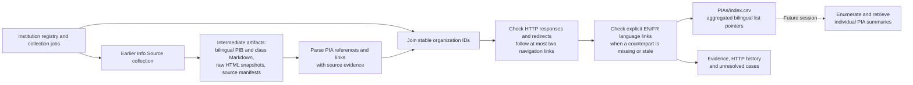

# PIA list discovery

This stage parses **intermediate artifacts produced earlier in the data
pipeline** to aggregate institutional links to Privacy Impact Assessment (PIA)
summary lists. French sources commonly refer to EFVP, EFRVP, or EFPV. It does
not collect or extract the individual assessments; that is a later stage.



## Outputs

- **`index.csv`**: one row for every organization in `institution_registry.csv`,
  including organizations without a usable source or discoverable link. Historical
  artifact-only institutions are also retained and flagged in `registry_membership`.
- **`evidence.jsonl`**: one record per organization/language, with inspected
  artifact paths, selected and alternative candidates, literal source context,
  artifact SHA-256, source URLs, and HTTP/navigation provenance. Explicit
  counterpart discoveries retain the originating page and its language link.
- **`build_manifest.json`**: generation time, registry and script checksums,
  output checksums, organization count, and resolution counts.

Registry/manifest `institution_id` is the join key. `registry_membership`
distinguishes `current_registry` from `artifact_only` records. `gc_orgID`, Open Canada organization
UUID and slug, and bilingual legal names are retained as additional identifiers.
Shared publication URLs remain separate rows when the registry has separate
legal entries (for example, National Defence and the Canadian Forces).

## Index columns

Columns ending in `_en` and `_fr` apply independently to each language.

| Column | Meaning |
| --- | --- |
| `pia_link_in_infosource` | **PIA Link in InfoSource (Y/N)**: Y if a PIA-list pointer was identified in either language's inspected artifacts. |
| `pia_link_in_infosource_en`, `_fr` | The same flag for each language; discovered counterpart URLs do not change this source-evidence flag. |
| `artifact_coverage_en`, `_fr` | `scanned` or `no_artifact`; distinguishes an unsuccessful search from absent source evidence. |
| `infosource_pia_url_en`, `_fr` | Original absolute URL extracted from the artifact, before navigation or repair. |
| `infosource_pia_http_status_en`, `_fr` | GET response code for the original pointer, after HTTP redirects. |
| `pia_list_url_en`, `_fr` | PIA-list URL reached through navigation or an explicit counterpart link; retains an intended candidate when inaccessible or unresolved. |
| `http_status_en`, `_fr` | GET response code for that list/candidate URL, after redirects: e.g. 200, 403, 404, 503. Blank when no URL was checked or a request failed before an HTTP response. |
| `final_url_en`, `_fr` | Final response URL after HTTP redirects. |
| `checked_at_utc_en`, `_fr` | Time of that HTTP observation (cached observations retain their original time). |
| `discovery_method_en`, `_fr` | `infosource_artifact` or `counterpart_language_link`; blank if undiscovered. |
| `resolution_en`, `_fr` | Content-resolution result, described below. |
| `review_note_en`, `_fr` | Specific attribution, language, or target problems observed during review. |

Resolution values:

- `list_detected`: response was 200 and the page contains assessment links or
  links under a PIA heading. A single published summary can form a valid list.
  This is a structural content check, not validation of the individual documents.
- `needs_review`: 200 response, but the list could not be established within
  the navigation budget, or institutional attribution needs review.
- `http_error`: non-200 HTTP response; the observed code is retained.
- `request_error`: connection, TLS, timeout, or other failure before a usable
  response. Details appear in evidence; no invented HTTP code is assigned.
- `no_link_found`: inspected artifacts did not yield a qualifying list pointer.
- `no_artifact`: no readable Markdown/HTML artifact was available for that
  language. This does not establish whether the institution publishes PIAs.
- `not_checked`: pointer extracted in `--offline` mode without HTTP checking.

**Y does not mean the link works, and 200 does not mean the target is a valid
PIA list.** In particular, the preserved FINTRAC pointer labels an ATI request
search as PIA summaries, and the IRB French pointer leads to IRCC's list.
Those cases remain visible instead of silently assigning another institution's
assessments. Missing URLs are left blank rather than guessed.

## Inputs and procedure

1. Read the registry and join per-institution `source_manifest.json` files by
   `institution_id`.
2. Parse bilingual `pibs_*.md` and `classes_of_records_*.md`, plus the primary
   raw HTML snapshots referenced by those manifests. Legacy `infosource_*.md`
   and HTML roles are included as well. Rebuilt Markdown includes
   selected supplemental captures. Do not reintroduce raw sources explicitly
   replaced by a supplemental capture. PDF captures are represented by their
   earlier Markdown conversion; this stage does not run PDF extraction again.
3. Identify English/French PIA terms and summary/publication references in link
   labels and nearby prose. Exclude policy/directive links, page fragments,
   generic menu-only mentions, and links clearly naming individual assessments.
   Rank explicit PIA-summary labels ahead of contextual links, then prefer
   references nearer the end of the source. Preserve alternative candidates.
4. Resolve relative URLs against the manifest's final/requested URL. Check with
   GET, follow HTTP redirects, and follow at most two explicit PIA/ATIP
   navigation links beyond the source pointer. Stop when a list is detected.
5. When the other language has a working list, inspect its explicit language
   switch to recover a missing or stale counterpart. Preserve the original
   pointer and its response code separately. Never synthesize translated URLs.
6. Write the aggregate and provenance. Individual PIA documents are not
   enumerated into a document collection or downloaded by this stage.

Extraction uses heuristics because institutional wording and layout vary.
`no_link_found` means no qualifying pointer was identified in these preserved
artifacts, not a claim about all current government websites. Lists can change
since the snapshot date. HTTP checks reflect the current execution environment;
403 or 503 can indicate access restrictions or temporary failures rather than
permanent removal. Review unresolved cases before using them as downstream
collection seeds. Explicitly labelled but misdirected source links are preserved.

## Run

From the repository root, using Python 3 (standard library only):

```sh
python PIAs/build_index.py
python PIAs/build_index.py --refresh
python -m unittest discover -s PIAs -p 'test_*.py' -v
```

The first command reuses GET observations cached under `work/pia_http_cache/`;
`--refresh` checks them again. `--offline` regenerates artifact-only outputs
without making HTTP requests and marks extracted pointers `not_checked`.
Temporary cached page text is excluded from version control; durable evidence
contains URLs and response metadata rather than collected assessment bodies.
No existing snapshots or upstream extraction tables are modified.
