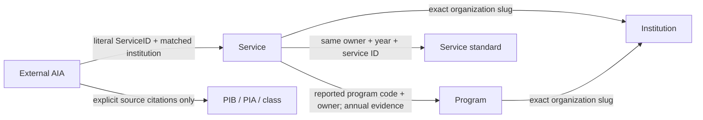

# Service Inventory: fields, joins and next datasets

The network now includes **1,879 services, 648 organization-scoped programs and
2,875 service standards**. The [full model](https://patlittle.github.io/pibs/data-model.html)
shows every source field and the graph projections. Start with
[Study Permit, service 1428](https://patlittle.github.io/pibs/graph.html?node=service%3Acic%3A1428)
to follow an actual AIA → service → program connection and inspect its standards.

## Owning sources and reproducible inventory

- User-supplied `service.json`: Recombinant Service Inventory schema, **46 service
  fields and 24 standard fields**. Its SHA-256 is
  `754f9da1bbe07788026e79243447a40fd351159fba796489a047d784edbe663a`, identical
  to the [published schema](https://open.canada.ca/data/recombinant-published-schema/service.json)
  inspected for this import. Descriptions and validation messages are source
  metadata, never instructions for the application or importer.
- The export omits primary/foreign-key declarations. Those were checked against
  the [operational Recombinant definition](https://github.com/open-data/ckanext-canada/blob/master/ckanext/canada/tables/service.yaml).
  Within an organization, service uses `(fiscal_yr, service_id)`; standard uses
  `(fiscal_yr, service_id, service_standard_id)` and references its same-year
  service. The aggregate publication requires **owner_org as an additional key**.
- Actual relationships come from the [published dataset](https://open.canada.ca/data/en/dataset/3ac0d080-6149-499a-8b06-7ce5f00ec56c),
  service resource `c0cf9766-b85b-48c3-b295-34f72305aaf6` and standard resource
  `8736cd7e-9bf9-4a45-9eee-a6cb3c43c07e`. Allowed-value lists in the schema
  alone do not establish a service/program relationship.
- `data/service_inventory/manifest.json` records source URLs, resource IDs,
  inspection time, input/output checksums, row counts and code-list exceptions.
  The six CSV snapshots are normalized reproducible inputs. `schema_fields.json`
  retains field definitions and choice counts; `field_join_audit.json` records
  a disposition for every field. The full raw schema is not duplicated.
- The external [AIA JSONL](https://patlittle.github.io/aia-eia-js/aia-analysis-data/aia-results.jsonl)
  remains configured in `site/aia-source.json` and fetched at runtime. No raw AIA
  records are copied into this repository.

| Fiscal year | Service observations | Standard observations |
|---|---:|---:|
| 2023–2024 | 1,721 | 2,345 |
| 2024–2025 | 1,733 | 2,414 |
| 2025–2026 | 139 | 140 |
| Total | 3,593 | 4,899 |

These are the inspected current resources, **not the separate 2018–2023 historical
resources**. The sparse 2025–2026 data is partial reporting, not a complete census.
There are no duplicate aggregate primary keys. All 4,899 standard observations
have an exact owner/year/service parent.

## Implemented joins

| Source → target | Common key and guard | Graph behavior |
|---|---|---|
| Service organization → institution registry | `owner_org = open_canada_org_slug`, exactly one registry match | Service and program `listed_by` institution. 79 of 82 source owners resolve. |
| Standard observation → service observation | `(owner_org, fiscal_yr, service_id)` | Service `has_standard` standard; each evidence item retains fiscal year. |
| Service observation → program reference | Tokenize repeated `program_id`, retain literal code, owner and fiscal year | Annual association is recorded for every reported code. Program names are not positionally zipped to codes. |
| Valid program reference → program | `(owner_org, program_id)`; literal allowed code and owner | Service `under_program` program, with annual evidence. 4,479 resolved annual associations. |
| Invalid/unknown program reference → reference node | Preserve literal code and resolution reason | 60 `-INV` observations remain unresolved references. The suffix is never removed. |
| External AIA → service | `data.ServiceID = service_id` as exact strings, **and** AIA resolves uniquely to the service's institution | `references_service`; no year or assessment coverage inferred. Missing or `N/A` creates no service node. Other unmatched IDs remain unresolved reference nodes. |



Stable graph identities are `service:{owner_org}:{service_id}`,
`program:{owner_org}:{program_id}`, and
`service-standard:{owner_org}:{service_id}:{service_standard_id}`. Segments are
URL encoded. Annual observations remain nested attributes, not separate graph
nodes. Full bilingual source fields, reporting years, online availability,
volumes, standards, targets and performance remain inspectable in the collapsed
information panel. Each annual observation is labelled by fiscal year.

Program codes are not assumed globally unique: common internal-service codes
and reorganizations require organization scope. The imported program labels are
from the inspected code list, not verified historical names. Valid-year hints
from that list remain separate from actual published observations: 4,430 of the
4,479 resolved references report years absent from the current choice snapshot.
They are retained as historical source assertions, with that status in evidence;
absence from a current code list does not prove a historical relationship invalid.

The current choice list assigns the codes in **21 published DFO service
observations (11 distinct service IDs)** to DND. These observations cover
2023–2024 and 2024–2025, before the **September 2, 2025 transfer of the Canadian
Coast Guard from Fisheries and Oceans to National Defence**. The user identified
this organizational history, confirmed by the
[official transfer announcement](https://www.canada.ca/en/department-national-defence/news/2025/09/national-defence-welcomes-the-canadian-coast-guard-to-the-defence-team.html)
and [transfer order SI/2025-96](https://gazette.gc.ca/rp-pr/p2/2025/2025-09-24/html/si-tr96-eng.html).
The difference between the historical reporting owner and the current code-list
owner is therefore expected transfer context, not evidence of an invalid source
identifier. The graph retains the original department and fiscal year, and shows
the code-list comparison under organization history. It does not retroactively
move the records or merge departmental identities by code alone. A future dated
succession crosswalk can explicitly connect predecessor and successor records;
the transfer announcement alone does not establish continuity for every program
or every similarly numbered service.

The three unmapped owner slugs are `fja-cmf`, `cas-satj`, `cics-scic`. Their service,
program and standard records remain accessible with their raw organization
identifier; an institution is not invented or selected by a similar title.

## AIA and privacy connections actually found

AIA package `452e10be-383d-4d7a-9c7d-6484dc366a4a` reports ServiceID `1428`.
Its uniquely matched IRCC institution and published `(cic, 1428)` service resolve
to **Study Permit**, which reports program **BGD02**. The service's automated
system flag is `N` in 2023–2024 and `Y` in 2024–2025. Both facts remain on their
own year; AIA risk level, survey version and responsible official stay on the AIA.

PSPC's AIA ServiceID `OMIS00034055` has no exact scoped inventory match and remains
unresolved. CFIA's `N/A` is missing, not an identifier. Similar titles, the presence
of an automated-system flag, and a shared department do not establish an AIA link.

No structured PIB identifier or legal instrument identifier exists in these 70
fields. Scanning the service rows' URLs and narrative fields found **zero exact
matches to the collected PIA source URLs**. No new direct service→PIB or
service→PIA edges were therefore added. Shared institution context is traversable
and is not represented as assessment coverage.

`sin_usage` and `cra_bn_identifier_usage` indicate reported use; they contain no
individual SIN or business number. Service types, recipient types, target groups,
channels, fees and online-service flags are attributes, not entities.

## Next joinable data, in recommended order

1. **GC InfoBase Federal Programs and program architecture.** The
   [GC InfoBase dataset](https://open.canada.ca/data/en/dataset/a35cf382-690c-4221-a971-cf0fd189a46f)
   Federal Programs resource `8d3cd22d-15b0-468a-bb75-c1e736107c45` exposes `year`,
   `organization_id`, `dept_code`, `program_code`, typed numeric `id`, `type`,
   `parent_type`, `parent_id` and bilingual names. Match Service Inventory
   **program_id to InfoBase program_code**, using `institution_registry.infobaseID`
   to crosswalk the organization and an explicitly verified fiscal-year mapping.
   Do not join the text code to InfoBase's numeric `id`/`program_id`. Then follow
   `(year, parent_type, parent_id)` to the typed `(year, type, id)` parent within
   the same organization after checking uniqueness. This is the strongest next
   extension: it can supply annual architecture and responsibility context.
2. **Program spending, FTEs and results.** The same InfoBase package supplies
   spending (`55934650-3380-44d5-82c1-bb68f8cc5abb`), FTE
   (`49569acc-b550-412e-b789-01d1ac96d879`) and result-indicator
   (`89bfbbec-ac42-48be-aa4f-7454bd7e10f8`) resources. Use the verified annual,
   organization-scoped program crosswalk first. These measures are annual
   attributes; distinct results/indicators may warrant their own entities.
3. **Justice laws and regulations, joined through explicit authority citations.**
   The [Justice XML dictionary](https://laws-lois.justice.gc.ca/eng/XML/index.html)
   defines instrument `UniqueID`, regulation IDs, bilingual counterpart links
   (`olid`), and `RegsMadeUnderAct/Reg@idref`; the
   [official bulk XML repository](https://github.com/justicecanada/laws-lois-xml)
   supplies the corpus. Build a legal instrument authority and resolve explicit
   citations from program mandates, PIB legal-authority text and PIA narratives
   to those identifiers, retaining citation evidence and validity dates. Service
   Inventory has no direct regulation ID: a regulatory service category or a
   similar title is insufficient. This needs a citation extraction/crosswalk step.
4. **Historical Service Inventory and organization/code history.** After the
   annual program join is verified, ingest the separate historical resources,
   preserving period and reorganizations. The government
   [service-data project](https://github.com/gcperformance/service-data) offers
   useful organization and service/program crosswalk candidates; audit those
   against authoritative identifiers before merging them. Resolve the three
   unmatched organizations explicitly. Model the Coast Guard transfer with
   effective dates and supported predecessor/successor service and program keys;
   preserve DFO observations before transfer and DND observations afterward.
   SI/2025-96 is also a concrete legal-instrument link for that organizational event.

These are proposed next extensions; hierarchy, finance and legal edges have not
been manufactured from this schema.

## Refresh and validation

Download the two CSV resources outside the checkout and run:

```sh
python scripts/import_service_inventory.py --schema /path/to/service.json \
  --services /path/to/service.csv --standards /path/to/service-std.csv
python scripts/build_graph.py
python scripts/build_network_schema.py
python validate_data_model.py
python scripts/validate_graph.py
python -m unittest tests.test_service_inventory tests.test_build_graph tests.test_network_schema
node --test tests/aia.test.mjs tests/graph.test.mjs tests/graph-focus.test.mjs
```

The importer rejects missing/duplicate aggregate keys, changed CSV columns and
orphan standards before writing snapshots. Validators preserve literal string
keys such as `NA` rather than treating them as empty values. Graph builds are
offline and deterministic from the normalized snapshots. External AIA values
remain browser-only; only their schema is inventoried by the full model builder.

## Every supplied field: join or attribute

The complete machine-readable decisions are in
[`field_join_audit.json`](../data/service_inventory/field_join_audit.json).

| Resource | Field | Source type | Treatment |
|---|---|---|---|
| service | `fiscal_yr` | text | annual observation key and temporal join guard |
| service | `service_id` | text | organization-scoped service identity; annual observation key |
| service | `service_name_en` | text | annual source attribute; not an identity join |
| service | `service_name_fr` | text | annual source attribute; not an identity join |
| service | `service_description_en` | text | annual source attribute; not an identity join |
| service | `service_description_fr` | text | annual source attribute; not an identity join |
| service | `service_type` | _text | repeated categorical attribute; not extra graph nodes |
| service | `service_recipient_type` | text | annual source attribute; not an identity join |
| service | `service_scope` | _text | repeated categorical attribute; not extra graph nodes |
| service | `client_target_groups` | _text | repeated categorical attribute; not extra graph nodes |
| service | `program_id` | _text | split repeated literal codes; join on owner_org + program_id; never strip -INV |
| service | `program_name_en` | _text | labels only; not positionally zipped to program IDs |
| service | `program_name_fr` | _text | labels only; not positionally zipped to program IDs |
| service | `client_feedback_channel` | _text | repeated categorical attribute; not extra graph nodes |
| service | `automated_decision_system` | text | reported attribute, not an entity identifier or proof of an assessment/individual/business link |
| service | `automated_decision_system_description_en` | text | narrative attribute; explicit PIA URLs/identifiers may provide evidence, not title-similarity joins |
| service | `automated_decision_system_description_fr` | text | narrative attribute; explicit PIA URLs/identifiers may provide evidence, not title-similarity joins |
| service | `service_fee` | text | annual source attribute; not an identity join |
| service | `os_account_registration` | text | annual source attribute; not an identity join |
| service | `os_authentication` | text | annual source attribute; not an identity join |
| service | `os_application` | text | annual source attribute; not an identity join |
| service | `os_decision` | text | annual source attribute; not an identity join |
| service | `os_issuance` | text | annual source attribute; not an identity join |
| service | `os_issue_resolution_feedback` | text | annual source attribute; not an identity join |
| service | `os_comments_client_interaction_en` | text | annual source attribute; not an identity join |
| service | `os_comments_client_interaction_fr` | text | annual source attribute; not an identity join |
| service | `last_service_review` | text | annual source attribute; not an identity join |
| service | `last_service_improvement` | text | annual source attribute; not an identity join |
| service | `sin_usage` | text | reported attribute, not an entity identifier or proof of an assessment/individual/business link |
| service | `cra_bn_identifier_usage` | text | reported attribute, not an entity identifier or proof of an assessment/individual/business link |
| service | `num_phone_enquiries` | text | annual source attribute; not an identity join |
| service | `num_applications_by_phone` | text | annual source attribute; not an identity join |
| service | `num_website_visits` | text | annual source attribute; not an identity join |
| service | `num_applications_online` | text | annual source attribute; not an identity join |
| service | `num_applications_in_person` | text | annual source attribute; not an identity join |
| service | `num_applications_by_mail` | text | annual source attribute; not an identity join |
| service | `num_applications_by_email` | text | annual source attribute; not an identity join |
| service | `num_applications_by_fax` | text | annual source attribute; not an identity join |
| service | `num_applications_by_other` | text | annual source attribute; not an identity join |
| service | `num_applications_total` | int | annual source attribute; not an identity join |
| service | `special_remarks_en` | text | annual source attribute; not an identity join |
| service | `special_remarks_fr` | text | annual source attribute; not an identity join |
| service | `service_uri_en` | text | source URL attribute; exact assessment-page matches only; no domain-only joins |
| service | `service_uri_fr` | text | source URL attribute; exact assessment-page matches only; no domain-only joins |
| service | `owner_org` | text | join: exact registry open_canada_org_slug |
| service | `owner_org_title` | text | context only; never substitute for organization ID |
| service-std | `fiscal_yr` | text | annual observation key and temporal join guard |
| service-std | `service_id` | text | organization-scoped service identity; annual observation key |
| service-std | `service_name_en` | text | annual source attribute; not an identity join |
| service-std | `service_name_fr` | text | annual source attribute; not an identity join |
| service-std | `service_standard_id` | text | service-scoped standard identity; annual standard observation key |
| service-std | `service_standard_en` | text | annual source attribute; not an identity join |
| service-std | `service_standard_fr` | text | annual source attribute; not an identity join |
| service-std | `type` | text | annual source attribute; not an identity join |
| service-std | `channel` | text | annual source attribute; not an identity join |
| service-std | `channel_comments_en` | text | annual source attribute; not an identity join |
| service-std | `channel_comments_fr` | text | annual source attribute; not an identity join |
| service-std | `target` | numeric | annual source attribute; not an identity join |
| service-std | `volume_meeting_target` | bigint | annual source attribute; not an identity join |
| service-std | `total_volume` | bigint | annual source attribute; not an identity join |
| service-std | `performance` | numeric | annual source attribute; not an identity join |
| service-std | `comments_en` | text | annual source attribute; not an identity join |
| service-std | `comments_fr` | text | annual source attribute; not an identity join |
| service-std | `target_met` | text | annual source attribute; not an identity join |
| service-std | `standards_targets_uri_en` | text | source URL attribute; exact assessment-page matches only; no domain-only joins |
| service-std | `standards_targets_uri_fr` | text | source URL attribute; exact assessment-page matches only; no domain-only joins |
| service-std | `performance_results_uri_en` | text | source URL attribute; exact assessment-page matches only; no domain-only joins |
| service-std | `performance_results_uri_fr` | text | source URL attribute; exact assessment-page matches only; no domain-only joins |
| service-std | `owner_org` | text | join: exact registry open_canada_org_slug |
| service-std | `owner_org_title` | text | context only; never substitute for organization ID |
