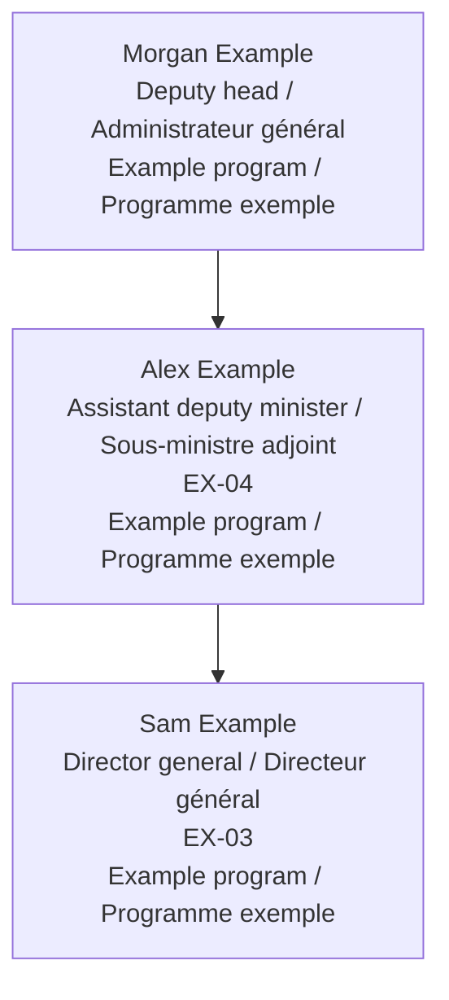

---
{
  "document_studio": "1.0.0",
  "document": {
    "schema_version": "1.0.0",
    "schema_id": "https://patlittle.github.io/pibs/document-studio/templates/document.schema.json",
    "document_id": "ds-1e7cfca1-ce77-4460-bc3d-95fa25176360",
    "status": "review_ready",
    "payload": {
      "kind": "organization_chart",
      "id": "ds-deff43e3-a75b-4b0b-8a71-cf9698b665dc",
      "title": {
        "en": "Fictional organization · example",
        "fr": "Organisation fictive · exemple"
      },
      "people": [
        {
          "kind": "person",
          "id": "ds-99fa612d-62a6-4724-b27d-c5b5c47773ed",
          "name": "Morgan Example",
          "position_title": {
            "en": "Deputy head",
            "fr": "Administrateur général"
          },
          "role_level": "deputy_head",
          "classification_group": "",
          "classification_level": "",
          "position_number": "",
          "organization": {
            "en": "Fictional Example Department",
            "fr": "Ministère fictif Exemple"
          },
          "programs": [
            {
              "kind": "program_assignment",
              "id": "ds-5eef4dd4-4d24-47d0-a0cf-bd9c75f39d23",
              "program_id": "EXAMPLE-01",
              "program_title": {
                "en": "Example program",
                "fr": "Programme exemple"
              },
              "owner_org": "fictional-example",
              "document_program_id": ""
            }
          ],
          "reports_to": "",
          "effective_from": "",
          "effective_to": "",
          "source_url": ""
        },
        {
          "kind": "person",
          "id": "ds-395180b5-6c48-4b11-8c82-6936fb8c8736",
          "name": "Alex Example",
          "position_title": {
            "en": "Assistant deputy minister",
            "fr": "Sous-ministre adjoint"
          },
          "role_level": "assistant_deputy_minister",
          "classification_group": "EX",
          "classification_level": "04",
          "position_number": "",
          "organization": {
            "en": "Fictional Example Department",
            "fr": "Ministère fictif Exemple"
          },
          "programs": [
            {
              "kind": "program_assignment",
              "id": "ds-46d05e3f-2604-417a-9d64-664f637eaab7",
              "program_id": "EXAMPLE-01",
              "program_title": {
                "en": "Example program",
                "fr": "Programme exemple"
              },
              "owner_org": "fictional-example",
              "document_program_id": ""
            }
          ],
          "reports_to": "ds-99fa612d-62a6-4724-b27d-c5b5c47773ed",
          "effective_from": "",
          "effective_to": "",
          "source_url": ""
        },
        {
          "kind": "person",
          "id": "ds-0b4772f0-3b68-4095-9228-e4838df72393",
          "name": "Sam Example",
          "position_title": {
            "en": "Director general",
            "fr": "Directeur général"
          },
          "role_level": "director_general",
          "classification_group": "EX",
          "classification_level": "03",
          "position_number": "",
          "organization": {
            "en": "Fictional Example Department",
            "fr": "Ministère fictif Exemple"
          },
          "programs": [
            {
              "kind": "program_assignment",
              "id": "ds-79b283d7-c113-44a1-8bb3-b224581ff662",
              "program_id": "EXAMPLE-01",
              "program_title": {
                "en": "Example program",
                "fr": "Programme exemple"
              },
              "owner_org": "fictional-example",
              "document_program_id": ""
            }
          ],
          "reports_to": "ds-395180b5-6c48-4b11-8c82-6936fb8c8736",
          "effective_from": "",
          "effective_to": "",
          "source_url": ""
        }
      ]
    }
  }
}
---

# Fictional organization · example / Organisation fictive · exemple

Review-ready document / Document prêt pour examen

Schema / Schéma: `1.0.0` · Document: `ds-1e7cfca1-ce77-4460-bc3d-95fa25176360`

## Chart title / Titre de l’organigramme

**English**

Fictional organization · example

**Français**

Organisation fictive · exemple

## People and reporting lines / Personnes et liens hiérarchiques

### Deputy head / Administrateur général

**Name / Nom:** Morgan Example

#### Position title / Titre du poste

**English**

Deputy head

**Français**

Administrateur général

**Role level / Niveau du poste:** Deputy head / Administrateur général

#### Organization / unit / Organisation / unité

**English**

Fictional Example Department

**Français**

Ministère fictif Exemple

#### Assigned programs / Programmes assignés

##### Example program / Programme exemple

**Program code / identifier / Code / identifiant du programme:** EXAMPLE-01

###### Program title / Titre du programme

**English**

Example program

**Français**

Programme exemple

**Organization code, if known / Code d’organisation, si connu:** fictional-example

### Assistant deputy minister / Sous-ministre adjoint

**Name / Nom:** Alex Example

#### Position title / Titre du poste

**English**

Assistant deputy minister

**Français**

Sous-ministre adjoint

**Role level / Niveau du poste:** Assistant deputy minister / Sous-ministre adjoint

**Classification group, if applicable / Groupe de classification, le cas échéant:** EX

**Classification level, if applicable / Niveau de classification, le cas échéant:** 04

#### Organization / unit / Organisation / unité

**English**

Fictional Example Department

**Français**

Ministère fictif Exemple

#### Assigned programs / Programmes assignés

##### Example program / Programme exemple

**Program code / identifier / Code / identifiant du programme:** EXAMPLE-01

###### Program title / Titre du programme

**English**

Example program

**Français**

Programme exemple

**Organization code, if known / Code d’organisation, si connu:** fictional-example

**Reports to / Relève de:** Morgan Example

### Director general / Directeur général

**Name / Nom:** Sam Example

#### Position title / Titre du poste

**English**

Director general

**Français**

Directeur général

**Role level / Niveau du poste:** Director general / Directeur général

**Classification group, if applicable / Groupe de classification, le cas échéant:** EX

**Classification level, if applicable / Niveau de classification, le cas échéant:** 03

#### Organization / unit / Organisation / unité

**English**

Fictional Example Department

**Français**

Ministère fictif Exemple

#### Assigned programs / Programmes assignés

##### Example program / Programme exemple

**Program code / identifier / Code / identifiant du programme:** EXAMPLE-01

###### Program title / Titre du programme

**English**

Example program

**Français**

Programme exemple

**Organization code, if known / Code d’organisation, si connu:** fictional-example

**Reports to / Relève de:** Alex Example

## Organization chart · entered reporting lines / Organigramme · liens hiérarchiques saisis

---
Template sources / Sources des modèles: [Info Source requirements](https://www.canada.ca/en/treasury-board-secretariat/services/access-information-privacy/access-information/access-informatio-policies-guidance/programs-holdings-online-publishing-requirements.html).

People, classifications, reporting lines and position/program assignments are project additions; they are not presented as official Info Source requirements. / Les personnes, classifications, liens hiérarchiques et affectations poste-programme sont des ajouts du projet; ils ne sont pas présentés comme des exigences officielles d’Info Source.
