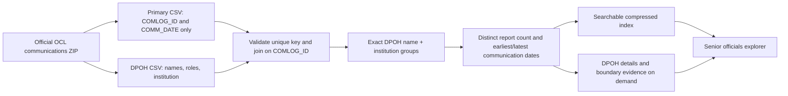

# GC Senior Officials Transparency

Standalone explorer: https://patlittle.github.io/pibs/gc_snr_officials/

This directory owns its HTML, CSS, browser JavaScript, CSVs, compressed snapshots,
collector, and tests. It has no runtime dependency on the PIBS app, ChatGPT Sites,
a Worker, or an external API. Serve this directory over HTTP; opening the HTML as
`file://` cannot load the local data files.

## Authority data

`sources.json` lists the seven designated-role sources. The collector writes each
source to its own UTF-8 CSV in `data/`, plus `appointments.csv` for the appointments
index. Appointment rows include organization-profile dates and a structured
`appointment_details` column for multiple roles. All CSVs carry source links and
access dates. Effective/appointment dates remain separate from access dates.

`data/manifest.json` records the last successful refresh, row count, and status
for each source. Empty/failed scrapes and declines of more than 50% retain the last
good CSV and produce warnings. Failed appointment profile requests retain prior
profile details when possible; the manifest lists affected URLs. Unavailable dates
remain unknown. The initial migration included designated-role snapshots from August 27, 2026
and an October 21, 2026 appointment collection. The Action refreshes all eight
sources, including TBS definition lists and audit committee tables. Rejected upstream requests do not silently erase good data.

Travel and hospitality are refreshed from the complete DataStore JSON dumps:

- https://open.canada.ca/data/en/datastore/dump/8282db2a-878f-475c-af10-ad56aa8fa72c?format=json
- https://open.canada.ca/data/en/datastore/dump/7b301f1a-2a7a-48bd-9ea9-e0ac4a5313ed?format=json

The collector streams downloads to temporary disk, then streams records with
`ijson`. It groups by exact **original** name, English title and organization ID,
retaining row counts and valid observed date windows. Separate original name
forms remain separate combinations. Blank-name rows remain in source totals but
cannot form person entities. Bad dates (non-ISO, before 1900 or more than 366 days
beyond retrieval) are flagged and excluded from windows, never from row counts.

Designated public office holder (DPOH) monthly communication reports use the official [OCL communications ZIP](https://lobbycanada.gc.ca/media/mqbbmaqk/communications_ocl_cal.zip).
`refresh_dpoh.py` streams the Windows-1252 CSVs from the archive and joins
`Communication_DpohExport.csv` to **only `COMLOG_ID` and `COMM_DATE`** from
`Communication_PrimaryExport.csv`. Client, registrant, submission, publication and
other primary-export columns are not retained. `COMLOG_ID` is validated as the
primary export's unique report key; one report can have multiple DPOH participants.
Conflicting primary dates or unmatched DPOH rows reject the refresh and retain the
last good snapshot.

Each exact original **DPOH first name + last name + institution** becomes one
aggregated observation. It retains all observed position, branch/unit and other-
institution labels; changes in those labels do not multiply a report's count.
The count is **distinct `COMLOG_ID` values per DPOH/institution**, with duplicate
participant rows removed. Counts on individual role variants can overlap and are never added to the group count. Different source spellings and institution labels stay
separate; these are observed combinations, not verified unique people. Distinct
report IDs remain distinct; the collector does not infer revisions from other
primary-export fields.

Earliest/latest observations use **`COMM_DATE`**, not filing/publication/access
dates. Invalid dates remain counted but are excluded from the date range and
flagged. Ties are resolved by numeric report ID. The earliest/latest report IDs,
dates and corresponding original DPOH rows are retained. These windows describe
reported communications, not tenure or current DPOH status.

`data/dpoh.json.gz` is the searchable rollup (names, institutions, all role titles,
counts and date boundaries). Full DPOH role/branch labels and boundary evidence
are in `data/dpoh_details/<bucket>.json.gz`, keyed by a stable hash of the exact
original grouping fields. The person dialog loads these details on demand;
client/registrant information is absent from both outputs. The DPOH source filter,
coverage card, freshness and About status are integrated with the existing app.
Name/nickname candidate matching includes these observations without automatic
identity merging. The next full OIC refresh also includes their observed names.



The initial 2026-11-12 snapshot contains **388,558 primary reports**, **595,194
DPOH source rows**, **594,644 distinct report/person observations**, and **62,608
exact DPOH/institution groups**. It removes **550 repeated report/person rows**;
there are **zero unmatched DPOH rows** and **zero invalid communication dates**.
Observed communications span **2008-07-02 to 2026-11-06**. Current counts, hashes
for the ZIP and both input members, encoding, join/group definitions and freshness
are always recorded in `data/manifest.json`; these counts are a dated snapshot.

**Observed refresh limitation (2026-11-12):** the official OCL ZIP was successfully
downloaded in the collection workspace, but GitHub-hosted runners receive HTTP
403 from the same endpoint, including with a browser-compatible client. Scheduled
runs retain the verified committed snapshot, its last-success date and counts;
the manifest and About panel expose `retained_after_error` and the HTTP error.
This does not remove the collected DPOH data. A fresh official download can be
replayed on an environment with access, then validated and committed:

```sh
python gc_snr_officials/scripts/refresh_dpoh.py --zip-file /path/to/communications_ocl_cal.zip
python gc_snr_officials/scripts/build_matches.py
python gc_snr_officials/scripts/validate.py --require-appointments
```

Local replay records its capture method and the ZIP/member hashes. The primary
export still contributes only the report ID and communication date.

OIC evidence uses `processed-csvs/orders.csv` from `PatLittle/oic-data`, pinned to
the upstream main commit at collection time. The Action matches complete observed
normalized names in order précis text and retains the matched original/normalized
text, date, PC number, précis and official attachment URLs. This is candidate
evidence, including mentions of former office holders, not verified appointment
or identity. Missing matches prove nothing. The index is searched on demand; it
does not add to observation counts. The collector does not need attachment text,
SQLite, or individual JSON files.

Each source records its own successful retrieval date, row/combination counts,
source URL, download SHA-256, and download size in `data/manifest.json`; OIC also
records its source commit and latest order date. Individual failures retain last
good data and expose warnings/freshness in About. The compressed JSON snapshots
and eight CSVs are committed to source control.

## Name fields

All eight authority CSVs, disclosure combinations and OIC matched names retain:

- `name_original`: exact source text, including source order and whitespace.
- `name_normalized`: given name + middle names/initials + family name for clear
  comma-separated family-first inputs; existing given-first forms retain order.
- `name`: compatibility alias for `name_normalized`, used for display/grouping.
- `name_prefix`, `name_suffix`: recognized honorifics/ranks and suffixes, separated
  from the presentation name.
- `name_normalization_method`, `name_normalization_review`: the deterministic
  conversion and whether interpretation is ambiguous.

Spelling, accents, capitalization, hyphens and initials are preserved. Ambiguous
multi-comma or single-token inputs are retained and flagged; the scripts do not
invent missing names or guess comma-free family-first order. All originals remain
available in the person dialog and search. Normalization occurs in the Action's
retrieval scripts, not as a browser display transform. Known office/redaction placeholders retain their original text but have an empty
presentation name and do not form person candidates. Matching confidence is
separate from presentation normalization. `names.py` owns the shared rules.

## Refresh and publish

`.github/workflows/gc-snr-officials.yml` runs daily at **08:00 UTC**, on changes to
this directory/its workflow, and via **Run workflow**. It tests the standalone code,
collects authority sources with at most six concurrent profile requests, commits
changed CSVs, compressed disclosure/DPOH/OIC indexes and the manifest to `main`, and deploys only this app to
`pages/gc_snr_officials`. Publishing occurs in the same workflow because commits
made with `GITHUB_TOKEN` do not trigger another push workflow.

All Pages writers share the existing `pages-branch-deploy` concurrency group.
The main site's `clean-exclude` list preserves `gc_snr_officials/**`. This app's
workflow neither builds nor validates the other PIBS sections and publishes only
its target directory. The Pages source remains the existing `pages` branch. Scheduled/manual runs and
collector/configuration changes refresh affected upstream sources; changes to
the external collector alone reuse committed authority CSVs; UI-only pushes reuse
committed data. DPOH refreshes run before the external OIC scan on scheduled/manual runs; changes to its collector refresh that source. Failed downloads, schema/key errors and declines over 50% retain the last good DPOH data and expose the error in About. Queued jobs check out current main so they do not republish stale
CSVs after another job refreshes them.

## Local checks

From the repository root:

```sh
python -m pip install -r gc_snr_officials/requirements.txt
python -m unittest discover -s gc_snr_officials/tests -p 'test_*.py'
node --test gc_snr_officials/tests/app.test.mjs
python gc_snr_officials/scripts/validate.py
python gc_snr_officials/scripts/refresh_sources.py
python gc_snr_officials/scripts/refresh_dpoh.py
python gc_snr_officials/scripts/refresh_external.py
python gc_snr_officials/scripts/validate.py --require-appointments
```

The tests run offline, covering source schemas, appointment dates, row spans,
failed-source retention, CSV quoting, all sort directions, data totals, local asset
paths, and dialog/OIC behaviour. The collector is the only command requiring live
source access. A first publication requires a nonempty appointments CSV.


Names and identity candidates
-----------------------------
`name` removes commas, periods and Unicode whitespace from the human-readable `name_normalized`; `name_original` retains the exact source. Normalization is done by the collectors and `scripts/build_matches.py`, including last-good datasets. Run the latter after the collectors (or offline to rebuild from committed data).

The daily Action refreshes the Apache-2.0 carltonnorthern/nicknames lookup, retains its last-good version on errors, records its SHA-256 and builds `data/matches.json.gz`. `data/nickname-supplements.csv` explicitly records the user-provided Alexandre/Alex relation. Direct nickname pairs or shared canonical names within a family-name-token block receive explainable scores from institution, role, middle-name and event-window evidence. See About for weights and limitations. These links are pairwise review candidates; no transitive identity merging or observation-count duplication occurs. The original consistency score remains separate from identity likelihood.

## Entity resolution graphic

[`assets/entity-resolution.svg`](assets/entity-resolution.svg) is a standalone, editable SVG explaining why name similarity is insufficient for entity resolution. It connects the disclosure source families to a proposed DPOH reference in Info Source and shows how controlled briefing-note recipients could distinguish people, dated roles and institutions. Dotted connections represent the proposed linkage. The graphic shows the repository registry’s 148 ATIA Schedule I institutions on two lines. Its person icon and symbols use SVG shapes for consistent rendering. The page includes an expandable preview, open by default, and SVG download; the deployment copies `assets/` alongside the app.
